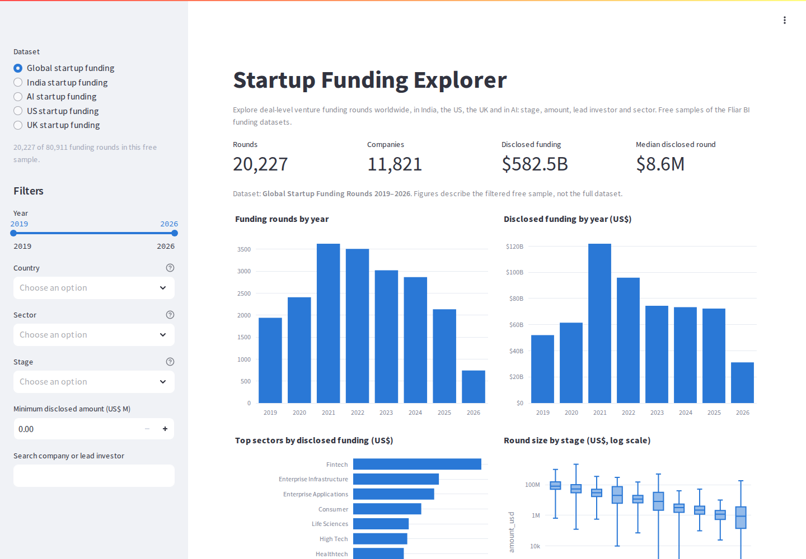
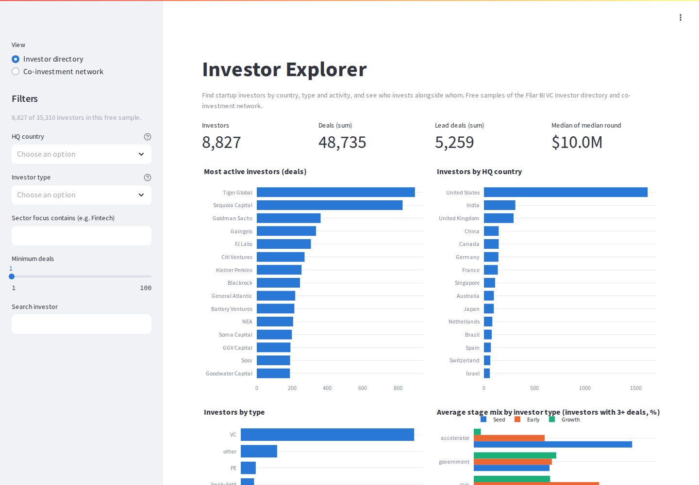
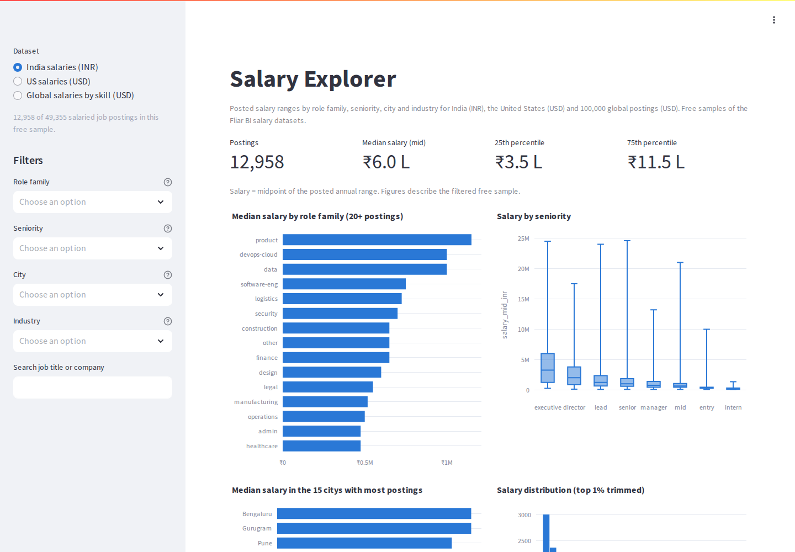
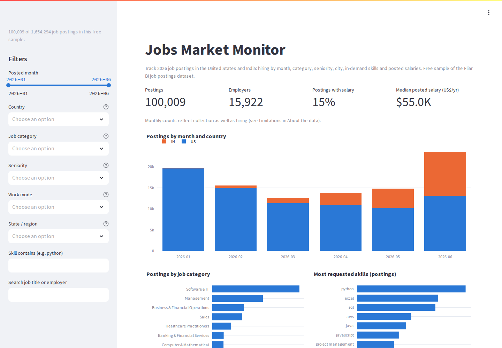
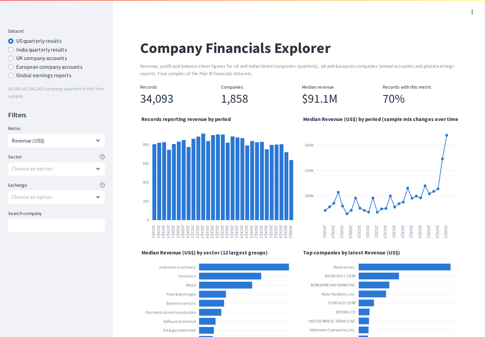
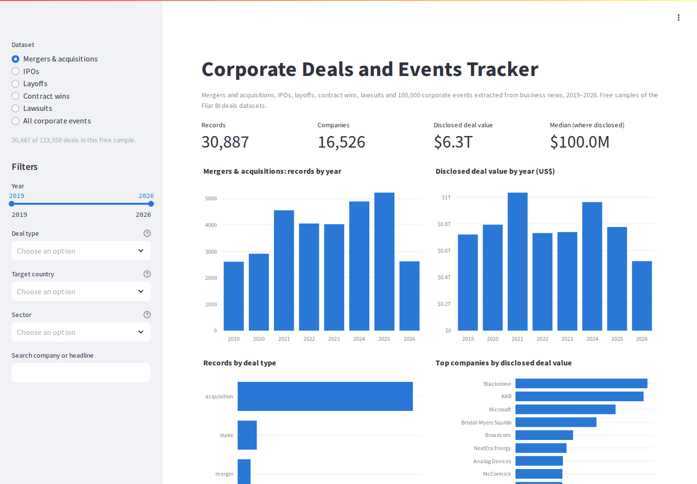
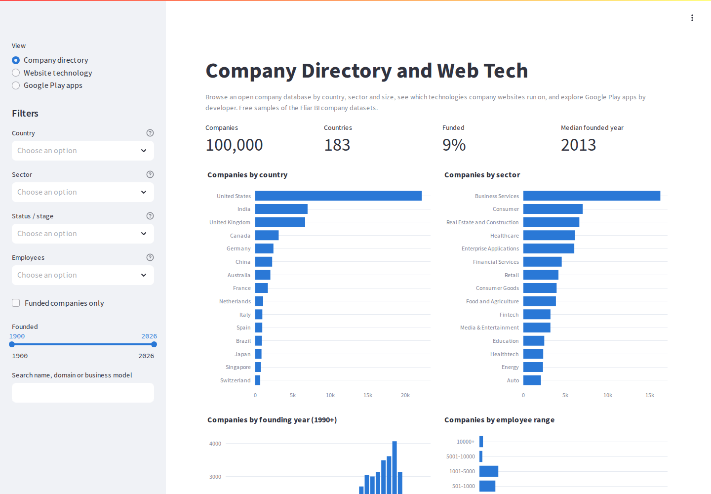
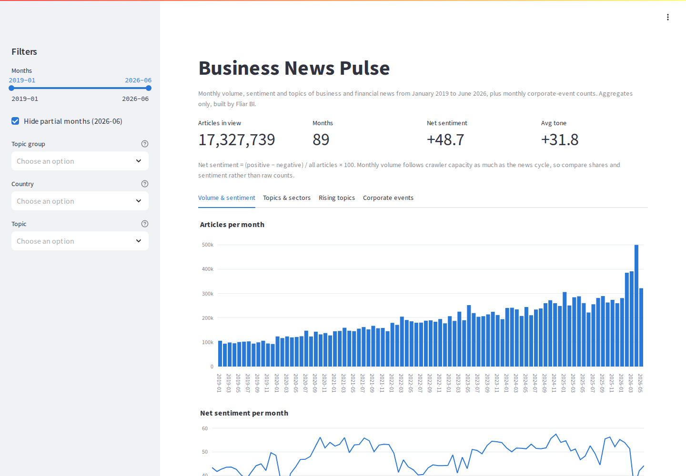

# Streamlit data apps by Fliar BI

Interactive explorers for the free [Fliar BI open company datasets](https://github.com/Busineessfree/open-company-datasets):
startup funding, investors, salaries, jobs, company financials, corporate deals, company and web-technology directories,
patents and business news. Every app has sidebar filters, KPI tiles, Plotly charts, a sortable table, a CSV download of the
filtered view and an **About the data** panel with the method, coverage and limitations of each dataset.

| App | What it shows | Live app | Main file | Datasets |
|---|---|---|---|---|
| **Startup Funding Explorer** | Funding rounds: global, India, AI, US and UK samples | deploy pending (runs locally) | `apps/startup_funding/streamlit_app.py` | [global-startup-funding](https://fliarbi.com/datasets/global-startup-funding/), [india-startup-funding](https://fliarbi.com/datasets/india-startup-funding/), [ai-startup-funding](https://fliarbi.com/datasets/ai-startup-funding/), [us-startup-funding-2019-2026](https://fliarbi.com/datasets/us-startup-funding-2019-2026/), [uk-startup-funding-2019-2026](https://fliarbi.com/datasets/uk-startup-funding-2019-2026/) |
| **Investor Explorer** | VC investor directory and co-investment network graph | deploy pending (runs locally) | `apps/investor_explorer/streamlit_app.py` | [vc-investor-directory](https://fliarbi.com/datasets/vc-investor-directory/), [investor-coinvestment-network](https://fliarbi.com/datasets/investor-coinvestment-network/) |
| **Salary Explorer** | Posted salaries for India, the US and 100k global postings | deploy pending (runs locally) | `apps/salary_explorer/streamlit_app.py` | [india-salary-benchmarks-2026](https://fliarbi.com/datasets/india-salary-benchmarks-2026/), [us-salary-benchmarks-2026](https://fliarbi.com/datasets/us-salary-benchmarks-2026/), [skill-salary-percentiles-global](https://fliarbi.com/datasets/skill-salary-percentiles-global/) |
| **Jobs Market Monitor** | 2026 job postings by month, category, skill, city and salary | deploy pending (runs locally) | `apps/jobs_monitor/streamlit_app.py` | [job-postings-2026](https://fliarbi.com/datasets/job-postings-2026/) |
| **Company Financials Explorer** | US and India quarterly results, UK and European accounts, global earnings | deploy pending (runs locally) | `apps/company_financials/streamlit_app.py` | [us-quarterly-results](https://fliarbi.com/datasets/us-quarterly-results/), [india-quarterly-results](https://fliarbi.com/datasets/india-quarterly-results/), [uk-company-financials-2019-2025](https://fliarbi.com/datasets/uk-company-financials-2019-2025/), [european-company-financials](https://fliarbi.com/datasets/european-company-financials/), [company-earnings-results](https://fliarbi.com/datasets/company-earnings-results/) |
| **Corporate Deals and Events Tracker** | M&A, IPOs, layoffs, contract wins, lawsuits, corporate events | deploy pending (runs locally) | `apps/corporate_deals/streamlit_app.py` | [mergers-acquisitions-2019-2026](https://fliarbi.com/datasets/mergers-acquisitions-2019-2026/), [ipo-tracker-2019-2026](https://fliarbi.com/datasets/ipo-tracker-2019-2026/), [layoffs-2019-2026](https://fliarbi.com/datasets/layoffs-2019-2026/), [contract-wins-2019-2026](https://fliarbi.com/datasets/contract-wins-2019-2026/), [lawsuits-2019-2026](https://fliarbi.com/datasets/lawsuits-2019-2026/), [corporate-events-2019-2026](https://fliarbi.com/datasets/corporate-events-2019-2026/) |
| **Company Directory and Web Tech** | Open company database, website technology stacks, Google Play apps | deploy pending (runs locally) | `apps/company_directory/streamlit_app.py` | [open-company-database](https://fliarbi.com/datasets/open-company-database/), [website-technology-stack](https://fliarbi.com/datasets/website-technology-stack/), [google-play-apps-2026](https://fliarbi.com/datasets/google-play-apps-2026/) |
| **Business News Pulse** | Monthly volume, sentiment and rising topics in business news, 2019–2026 (aggregates) | deploy pending (runs locally) | `apps/business_news_pulse/streamlit_app.py` | [corporate-events-2019-2026](https://fliarbi.com/datasets/corporate-events-2019-2026/) |

## How the apps get their data

- **Dataset samples** are read at run time from the published Hugging Face parquet files
  (`https://huggingface.co/datasets/<repo>/resolve/main/data/train.parquet`), only the needed columns, cached with `st.cache_data`.
- **Aggregate bundles** (patents, web technology, business news) are small parquet files committed under `data/<theme>/`.
- Shared code lives in `common/`: `data.py` (loading), `ui.py` (page setup, filters, charts, table, CSV download, About panel)
  and `meta.json` (titles, links, method, coverage and limitations copied from each dataset card).

## Run locally

```bash
python -m venv .venv && . .venv/bin/activate
pip install -r requirements.txt
streamlit run apps/startup_funding/streamlit_app.py
```

Any app folder works the same way. Tested on Python 3.11 and 3.12.

## Deploy on Streamlit Community Cloud

Create one app per folder: repository `streamlit-data-apps`, branch `main`, main file `apps/<folder>/streamlit_app.py`.
`requirements.txt` at the repository root is shared by all apps.

## Screenshots

**Startup Funding Explorer**



**Investor Explorer**



**Salary Explorer**



**Jobs Market Monitor**



**Company Financials Explorer**



**Corporate Deals and Events Tracker**



**Company Directory and Web Tech**



**Business News Pulse**



## Licence and contact

Data: [CC BY-NC 4.0](https://creativecommons.org/licenses/by-nc/4.0/), attribution **Fliar BI** (https://fliarbi.com).
App code: MIT. Dataset hub: https://fliarbi.com/datasets/ · Full data and API access: b2b@fliarbi.com
